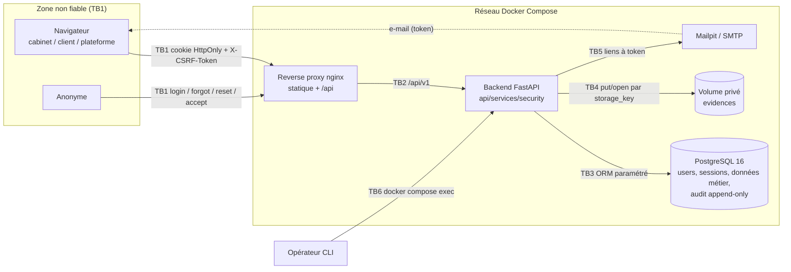

# ChainScope — Modèle de menaces (équipe A)

- **Auteur :** rôle Expert Cyber — issue #3
- **Statut :** version initiale J1 (avant implémentation). Révisée à chaque PR sensible et en J4 (#26).
- **Sources normatives :** `01_SPECIFICATIONS_ET_ARCHITECTURE.md` (§1, §3–§8), `02_PLAN_DE_TEST_ET_SECURITE.md` (F01–F20, §3, §6). Décisions d'implémentation : `docs/DECISIONS.md` (ADR-006 à ADR-016).
- **Ce document ne modifie aucun contrat.** Les points non tranchés par la spec sont signalés comme *hypothèse de travail* et renvoient à une `architecture-question` (#29, #30, #31, #35).
- **Conformité :** aucune conformité OWASP ASVS n'est revendiquée (01 §8). Les contrôles listés en §12 sont *visés* ; seuls ceux couverts par un test exécuté et journalisé pourront être déclarés « vérifiés » dans `docs/QA_REPORT.md`.
- **Données :** exclusivement fictives (02 §1). Aucun scan de service tiers ; toutes les vérifications s'exécutent sur instance locale.

## 1. Actifs à protéger

| ID | Actif | C | I | D | Remarque |
|---|---|---|---|---|---|
| A1 | Constats non publiés (titre, description, impact, recommandation, CVSS) | **Haute** | Haute | Moy. | Cœur confidentiel ; invisibles au client même avec l'UUID (01 §4) |
| A2 | Preuves (fichiers) et leurs métadonnées (`storage_key`, chemin) | **Critique** | Haute | Moy. | Peuvent contenir captures d'écran sensibles ; critère bloquant 02 §6 |
| A3 | Graphe d'attaque et chemins vers les crown jewels | Haute | Haute | Moy. | Cartographie de compromission du client |
| A4 | Identifiants : hash Argon2id, tokens de session, CSRF, invitation, reset | **Critique** | Haute | — | Seuls des hachés en base (01 §8) |
| A5 | Memberships et rôles (`tenant_memberships`, `client_memberships`, `platform_admins`) | Moy. | **Critique** | Haute | Source unique d'autorisation |
| A6 | Frontière tenant (données de chaque cabinet) | **Critique** | Critique | — | Fuite cross-tenant = blocage (02 §6) |
| A7 | Journal d'audit | Moy. | **Haute** | Moy. | Append-only ; doit rester sans secret |
| A8 | Données personnelles minimales (e-mails) | Moy. | Moy. | — | Minimisation (01 §8) |
| A9 | Configuration et secrets d'exécution (`.env`, DSN, SMTP) | **Critique** | Haute | — | Jamais commités ; `.env.example` sans secret |
| A10 | Disponibilité de l'API (calcul de chemins, upload) | — | — | Haute | DoS applicatif borné par plafonds |
| A11 | Liste des tenants / clients | Moy. | Moy. | — | Aucun endpoint public de liste globale (01 §6) |

## 2. Acteurs

| Acteur | Authentification | Capacités légitimes | Menaces typiques |
|---|---|---|---|
| Anonyme (Internet / réseau local) | Aucune | login, forgot/reset, accept-invitation, health | Brute force, énumération de comptes, CSRF de connexion, rejeu de token |
| `PLATFORM_ADMIN` | Session | CRUD tenants, stats d'exploitation, invitation du 1er `TENANT_ADMIN` (hyp. AQ #29) | Curiosité : lecture de données métier (interdite par défaut, 01 §1) |
| `TENANT_ADMIN` (tenant T) | Session + membership T | Clients, invitations, membres, missions, constats, preuves, audit de T | Débordement vers un autre tenant ; mass assignment |
| `PENTESTER` (tenant T) | Session + membership T | Actifs, constats, graphe, preuves, publication dans T | Escalade vers admin (invitations, statut mission, audit) |
| `CLIENT_VIEWER` (client_org C de T) | Session + membership C | Lecture des engagements de C, constats publiés, preuves visibles+publiées | Devinette d'UUID, accès aux routes cabinet, champs internes, autres clients |
| Membre d'un autre tenant (ex. admin Boreal) | Session valide ailleurs | Rien sur T | IDOR par substitution d'IDs (URL, JSON, filtres) |
| Client d'un autre tenant/client_org (ex. lecteur Boreal) | Session valide ailleurs | Rien sur C | IDOR sur portail client et téléchargement |
| Utilisateur révoqué / tenant suspendu | Ancienne session | Rien | Réutilisation de session |
| Opérateur infra (dev) | Accès Docker | Exploitation | Fuite de secrets par logs / volumes |

## 3. Frontières de confiance

| ID | Frontière | Ce qui la traverse | Hypothèse |
|---|---|---|---|
| TB1 | Navigateur ↔ reverse proxy (nginx / Vite) | HTTPS (prod), cookies, JSON, multipart | Tout le contenu du navigateur est non fiable, y compris rôles, `tenant_id`, MIME |
| TB2 | Reverse proxy ↔ backend FastAPI | HTTP interne `/api` | Le backend est la seule autorité ; il n'est pas exposé directement à l'hôte en prod |
| TB3 | Backend ↔ PostgreSQL | SQL paramétré (ORM) | DB accessible uniquement depuis le réseau Compose |
| TB4 | Backend ↔ volume de preuves | Fichiers par `storage_key` | Volume monté **uniquement** dans le backend, jamais servi statiquement |
| TB5 | Backend ↔ SMTP (Mailpit dev) | Liens d'invitation / reset | Le canal e-mail transporte des tokens : traiter comme sensible |
| TB6 | Opérateur ↔ CLI (`create-platform-admin`, `seed-demo`) | Secrets saisis | Mot de passe par prompt masqué ou variable d'env, jamais en argument de ligne de commande ni dans le dépôt |
| TB7 | Portée logique : tenant ↔ tenant, client_org ↔ client_org, cabinet ↔ portail client | Identifiants dans l'URL / body | Chaque ressource est rechargée avec le périmètre du principal (§7) |

## 4. Diagramme de flux

Flux sensibles : (1) login → session ; (2) invitation → e-mail → acceptation ; (3) forgot → e-mail → reset ; (4) upload multipart → validation → volume ; (5) download (cabinet / client) → contrôles → flux fichier ; (6) mutation de constat/edge → recalcul des chemins ; (7) toute mutation → audit.

## 5. Analyse STRIDE par composant

Légende : S usurpation, T altération, R répudiation, I divulgation, D déni de service, E élévation de privilège. « Test » renvoie à 02 (F.. ou §3) ; « SEC-* » = test complémentaire à écrire dans `tests/security/` (#26).

### 5.1 Authentification, sessions, CSRF (#8, #9, #17)

| ID | STRIDE | Menace | Contrôle attendu | Test |
|---|---|---|---|---|
| T-AUTH-01 | S | Brute force / credential stuffing sur `/auth/login` | Rate limit IP + e-mail haché (ADR-007), 429 normalisé, Argon2id | SEC-RL-login |
| T-AUTH-02 | I | Énumération de comptes par message / timing | Message unique, hash factice si compte absent | 02 §3 sessions |
| T-AUTH-03 | S | Vol de cookie par XSS | `HttpOnly`, CSP (#26), rendu échappé | 02 §3 « cookie absent de JS » |
| T-AUTH-04 | S | Fixation de session | Nouveau token à chaque login ; toute session présentée au login est révoquée | SEC-fixation |
| T-AUTH-05 | S | Session expirée / révoquée / altérée réutilisée | Recherche par `SHA-256(token)` + `expires_at` + `revoked_at` + `users.is_active` à **chaque** requête | F01, 02 §3 |
| T-AUTH-06 | S | Anciennes sessions après reset du mot de passe | Révocation de toutes les sessions de l'utilisateur | 02 §3, #15 |
| T-AUTH-07 | T/E | CSRF sur mutation cookie | `X-CSRF-Token` lié à la session, comparaison temps constant, `SameSite=Lax`, contrôle `Origin` (#26) | F16 |
| T-AUTH-08 | S | CSRF de connexion (victime connectée au compte de l'attaquant) | Contrôle `Origin` sur `/auth/login` et routes à token ; `SameSite=Lax` | SEC-login-origin |
| T-AUTH-09 | I | Token dans URL, logs, HTML, `localStorage` | Cookie seulement ; CSRF en mémoire (ADR-014) ; logs sans en-têtes `Cookie` ni corps | 02 §3, F18 |
| T-AUTH-10 | I | Fuite de dump DB → sessions utilisables | Seuls des SHA-256 de tokens 256 bits stockés | #8 test « token jamais en clair » |
| T-AUTH-11 | E | Mot de passe admin fixé dans les sources / seed | CLI explicite (#9), mots de passe par prompt/env, seed refusé en prod (#25) | F20 (grep secrets) |
| T-AUTH-12 | R | Login nié | Audit `auth.login.success/failure` avec request_id | F18 |

### 5.2 Invitations et réinitialisation (#15, #16)

| ID | STRIDE | Menace | Contrôle attendu | Test |
|---|---|---|---|---|
| T-INV-01 | S | Rejeu d'invitation / reset | `consumed_at` posé atomiquement (`UPDATE … WHERE consumed_at IS NULL AND expires_at > now()` ou verrou) | F02, 02 §3 |
| T-INV-02 | S | Token expiré | Expiration courte configurable | 02 §3 |
| T-INV-03 | E | Rôle choisi par l'invité (`role` dans le body d'acceptation) | Rôle et périmètre lus **uniquement** depuis l'invitation stockée ; `extra="forbid"` | F17 |
| T-INV-04 | E | PENTESTER invite un admin / un client | Invitation membres et clients : `TENANT_ADMIN` seulement ; `PLATFORM_ADMIN` : `role=TENANT_ADMIN` seulement (hyp. AQ #29) | SEC-RBAC |
| T-INV-05 | I | Token exposé par URL (logs nginx, Referer, historique) | Token dans le **fragment** (`#token=`), `Referrer-Policy: no-referrer`, retrait de l'historique (#17), aucun log de query | SEC-token-url |
| T-INV-06 | I | Énumération via forgot-password (réponse ou timing) | 202 identique ; envoi d'e-mail hors du chemin de réponse | 02 §3 |
| T-INV-07 | S | Acceptation d'une invitation pour un compte existant sans preuve de possession du compte | Hypothèse de travail : vérifier le mot de passe du compte existant avant d'ajouter le membership (commentaire #16) | SEC-invite-existing |
| T-INV-08 | E | Invitation d'un tenant A utilisée sur B | `tenant_id`/`client_org_id` portés par l'invitation, jamais par le body | #16 |
| T-INV-09 | D | Spam d'invitations / reset (abus SMTP) | Rate limit forgot ; invitations réservées aux admins authentifiés | SEC-RL-forgot |

### 5.3 API multi-tenant cabinet (#10, #12, #13, #14)

| ID | STRIDE | Menace | Contrôle attendu | Test |
|---|---|---|---|---|
| T-API-01 | I/E | IDOR : substitution de `tenant_id`, `engagement_id`, `finding_id`, `asset_id`, `client_id` | Chargement « ressource + périmètre » en une requête (ADR-008) ; 404 uniforme | 02 §3 isolation, F11 |
| T-API-02 | E | Mass assignment (`tenant_id`, `role`, `created_by`, `published_at`, `engagement_id`, `status` hors route) | Schémas `extra="forbid"` ; champs serveur jamais en entrée | F17 |
| T-API-03 | T | Référence croisée dans le body (`client_org_id` d'un autre tenant, asset d'un autre engagement) | Validation service + FK composites (#7) ; 400 `INVALID_REFERENCE` identique à « inexistant » | F11, 02 §3 |
| T-API-04 | I | Listes ou filtres renvoyant des données du voisin | Filtre tenant appliqué dans le repository, jamais optionnel ; filtres `client_org_id` revalidés | 02 §3 |
| T-API-05 | T | Mutation sur mission `CLOSED` | Garde `ensure_engagement_open` → 409 (hyp. AQ #30) | 02 §3 logique |
| T-API-06 | E | Réaffectation d'engagement à un autre client (`client_org_id` en PATCH) exposant ses constats publiés | Recommandation : `client_org_id` non modifiable après création (commentaire #13) | SEC-reassign |
| T-API-07 | I | `PLATFORM_ADMIN` lit des données métier | Aucune policy plateforme sur les routes métier ; 404 | SEC-RBAC |
| T-API-08 | E | Membre d'un tenant suspendu continue d'opérer | Vérif `tenants.is_active` dans la résolution du périmètre (cabinet **et** portail client) | #12 |
| T-API-09 | T | Injection SQL via `q`, tri, filtres | ORM paramétré ; tri par liste blanche ; échappement `%`/`_` en `ILIKE` | SEC-sqli |
| T-API-10 | D | Pagination abusive | `limit <= 100` (422), plafonds 150 actifs / 300 edges | 02 §3 |

### 5.4 Portail client (#19, #23)

| ID | STRIDE | Menace | Contrôle attendu | Test |
|---|---|---|---|---|
| T-CLI-01 | I | Lecture d'un constat non publié par UUID connu | `published_at IS NOT NULL` dans la requête ; 404 | F05 |
| T-CLI-02 | I | Lecture d'un constat publié d'un autre client | Jointure `client_memberships` → `engagements.client_org_id` | F06 |
| T-CLI-03 | E | Écriture depuis le portail (PATCH, publish) | Aucune route mutante sous `/client` ; routes cabinet → 404 pour un client | F07 |
| T-CLI-04 | I | Champs internes dans la réponse (`created_by`, `storage_key`, preuves non visibles, `tenant_id`) | Schéma dédié `ClientFindingOut` (liste blanche) ; test sur les clés | 02 §3 |
| T-CLI-05 | I | Fuite côté frontend (DOM, cache TanStack, erreurs) | Portail ne consomme que `/client/*` ; cache vidé au logout (ADR-014) | 10_UX, #23 |
| T-CLI-06 | I | Rétractation non effective (constat dépublié encore visible / preuves encore téléchargeables) | Règle évaluée à chaque requête, aucune copie dénormalisée | SEC-unpublish |

### 5.5 Upload / download des preuves (#20)

| ID | STRIDE | Menace | Contrôle attendu | Test |
|---|---|---|---|---|
| T-EVD-01 | T/E | Fichier actif déguisé (exe en `.png`, HTML en `.txt`, SVG) | Liste blanche PDF/PNG/JPEG/TXT ; extension + Content-Type + signature concordants ; TXT = UTF-8 sans NUL | F14, 02 §3 |
| T-EVD-02 | T | Path traversal via nom de fichier | `storage_key` UUID4 ; nom d'origine en métadonnée seulement | #20 (`../../etc/passwd.png`) |
| T-EVD-03 | D | Fichier > 10 Mio, upload lent, remplissage disque | Coupure en flux à 10 Mio → 413 ; `client_max_body_size` nginx cohérent ; suppression du temporaire | F14 |
| T-EVD-04 | I | Accès direct au stockage | Volume hors webroot, aucune route statique ; download uniquement via route autorisée | F12, F13 |
| T-EVD-05 | I | Client devine un `evidence_id` | Download client : membership client **et** finding publié **et** `client_visible=true`, sinon 404 | F13 |
| T-EVD-06 | I | IDOR cabinet : `evidence_id` d'un autre engagement sous un `engagement_id` autorisé | Requête `evidence.id = :id AND evidence.engagement_id = :eid AND tenant_id = périmètre` | SEC-RBAC |
| T-EVD-07 | T/I | XSS / sniffing au téléchargement | `Content-Disposition: attachment` (nom assaini, `filename*` RFC 6266, CR/LF retirés), `nosniff`, `Content-Type` = MIME vérifié, `Cache-Control: no-store`, recommandé `Content-Security-Policy: sandbox` | F12, 02 §3 |
| T-EVD-08 | R | Téléchargement nié | Audit `evidence.download` (cabinet et client) | F18 |
| T-EVD-09 | T | Altération du fichier stocké | SHA-256 calculé serveur à l'upload, exposé au cabinet | F12 |

### 5.6 Graphe et chemins (#21, #22)

| ID | STRIDE | Menace | Contrôle attendu | Test |
|---|---|---|---|---|
| T-GRA-01 | T | Edge reliant des objets d'un autre engagement / tenant | Service + FK composites ; 400 `INVALID_REFERENCE` ; état inchangé | F11 |
| T-GRA-02 | D | Explosion combinatoire (graphe dense, cycles) | Chemins simples ≤ 6, top 20, plafonds 150/300, budget d'expansions (ADR-011) | 02 §3 logique, SEC-dos-paths |
| T-GRA-03 | T | Chemin calculé côté client / falsifié | Calcul serveur uniquement ; front affiche la réponse (10_UX) | F08 |
| T-GRA-04 | I | Fuite de libellés via graphe d'un autre engagement | Mêmes policies d'engagement que les autres routes | SEC-RBAC |
| T-GRA-05 | T | Statut `REMEDIATED` contourné / `ACCEPTED_RISK` traité comme corrigé | Filtre d'edges actifs dans le service | F09, F10 |

### 5.7 Journal d'audit (#11)

| ID | STRIDE | Menace | Contrôle attendu | Test |
|---|---|---|---|---|
| T-AUD-01 | T/R | Modification / suppression d'événements | Aucune route, trigger refusant UPDATE/DELETE (ADR-016) | #7 test trigger |
| T-AUD-02 | I | Secrets ou données personnelles dans `metadata_json` | Liste blanche de clés, filtre `password/token/csrf/cookie/hash/secret` | F18 |
| T-AUD-03 | I | Lecture de l'audit d'un autre tenant / par PENTESTER | `TENANT_ADMIN` du tenant seulement ; PENTESTER 403 ; autre tenant 404 | #11 |
| T-AUD-04 | R | Événement perdu si la mutation échoue / échec de login non journalisé | Même transaction pour les mutations ; transaction dédiée pour les échecs de login | F18 |

### 5.8 Docker, configuration, exploitation (#5, #6, #26)

| ID | STRIDE | Menace | Contrôle attendu | Test |
|---|---|---|---|---|
| T-OPS-01 | I | Secrets commités | `.env.example` avec `change-me`, `.env` ignoré, revue du diff | F20 |
| T-OPS-02 | I | Debug / stacktrace en production | `APP_ENV=production` ⇒ debug off, handler 500 générique | 02 §3, #5 |
| T-OPS-03 | I/T | PostgreSQL ou backend exposé sur l'hôte | Ports publiés : proxy seulement en prod ; DB sur réseau interne | revue Compose |
| T-OPS-04 | E | Conteneur backend root, volume preuves monté ailleurs | Utilisateur non root ; volume `evidences` monté seulement dans `backend` | revue Compose |
| T-OPS-05 | I | En-têtes de sécurité absents | CSP `default-src 'self'`, `frame-ancestors 'none'`, `Referrer-Policy`, `nosniff`, HSTS en HTTPS, CORS sans `*` | #26 |
| T-OPS-06 | I | Mailpit exposé hors dev | Service dev uniquement (profil Compose ou override) | revue Compose |
| T-OPS-07 | D | Compteurs de rate limit perdus au redémarrage / multi-worker | Un seul worker (ADR-007) ; limite documentée (§13) | — |
| T-OPS-08 | T | Dépendances compromises | Lockfiles `uv.lock` / `package-lock.json`, versions figées | CI |

## 6. Ordre de traitement d'une requête (invariant)

1. **401** si pas de session valide (sauf routes anonymes de §7).
2. **403 `CSRF_FAILED`** si méthode mutante cookie-based sans `X-CSRF-Token` valide.
3. **Périmètre** : chargement de la ressource parente (tenant / engagement / client_org) filtré par les memberships du principal (lus en base) → **404** si absente ou hors périmètre.
4. **Rôle** dans ce périmètre insuffisant → **403** (décidé **avant** tout chargement de ressource enfant, pour que la réponse ne dépende pas de l'existence de l'enfant).
5. Chargement de l'enfant **dans** le parent (`child.engagement_id = parent.id`) → **404**.
6. Validation (422 schéma, 400 métier/`INVALID_REFERENCE`), état (409 `ENGAGEMENT_CLOSED`, `LIMIT_REACHED`), taille (413).

## 7. Matrice RBAC

### 7.1 Règles 403 / 404 (application d'ADR-008)

- **R1** — Routes `/tenants/{tenant_id}/*` et `/engagements/{engagement_id}/*` (cabinet) : sans membership cabinet (`TENANT_ADMIN`/`PENTESTER`) dans le tenant de la ressource → **404**. Cela vaut pour `CLIENT_VIEWER` (même sur son propre engagement), `PLATFORM_ADMIN` et membres d'un autre tenant. Ainsi un client ne peut pas distinguer un UUID cabinet existant d'un UUID inexistant.
- **R2** — Membre cabinet du tenant mais rôle insuffisant (`PENTESTER` sur route admin) → **403** : l'existence du tenant/engagement lui est déjà connue.
- **R3** — Routes `/platform/*` : capacité globale, non liée à une ressource métier → **403** pour tout authentifié non `PLATFORM_ADMIN` (rien à cacher). Exception AQ #29 (hyp.) : `PLATFORM_ADMIN` peut appeler `POST /tenants/{tenant_id}/members` avec `role=TENANT_ADMIN` uniquement (sinon 403) ; il reste en 404 sur toutes les autres routes du tenant.
- **R4** — Routes `/client/*` : listes filtrées par `client_memberships` (200, éventuellement vide, pour tout authentifié) ; détail / download hors périmètre, non publié ou non visible → **404**.
- **R5** — Anonyme → **401** sur toute route non listée comme anonyme.
- **R6** — Tenant suspendu (`is_active=false`) : hypothèse de travail (#12) — 403 `TENANT_SUSPENDED` pour ses membres cabinet, ses engagements exclus du portail client (404).

### 7.2 Matrice route × rôle

Colonnes : **ANO** anonyme · **PA** `PLATFORM_ADMIN` sans membership · **TA** `TENANT_ADMIN` du tenant · **PT** `PENTESTER` du tenant · **CV** `CLIENT_VIEWER` du client_org propriétaire · **XT** membre cabinet d'un autre tenant · **XC** `CLIENT_VIEWER` d'un autre client_org / tenant. ✔ = autorisé (code nominal). « CSRF » = `X-CSRF-Token` exigé. Les codes 409/413/422 éventuels ne sont pas répétés.

| # | Route (`/api/v1`) | ANO | PA | TA | PT | CV | XT | XC |
|---|---|---|---|---|---|---|---|---|
| 1 | `POST /auth/login` | ✔ 200 | ✔ | ✔ | ✔ | ✔ | ✔ | ✔ |
| 2 | `GET /auth/me` | 401 | ✔ | ✔ | ✔ | ✔ | ✔ | ✔ |
| 3 | `GET /auth/csrf` | 401 | ✔ | ✔ | ✔ | ✔ | ✔ | ✔ |
| 4 | `POST /auth/logout` (CSRF) | 401 | ✔ 204 | ✔ | ✔ | ✔ | ✔ | ✔ |
| 5 | `POST /auth/forgot-password` | ✔ 202 | ✔ 202 | ✔ 202 | ✔ 202 | ✔ 202 | ✔ 202 | ✔ 202 |
| 6 | `POST /auth/reset-password` (token) | ✔ | ✔ | ✔ | ✔ | ✔ | ✔ | ✔ |
| 7 | `POST /auth/accept-invitation` (token) | ✔ | ✔ | ✔ | ✔ | ✔ | ✔ | ✔ |
| 8 | `GET /platform/tenants` | 401 | ✔ | 403 | 403 | 403 | 403 | 403 |
| 9 | `POST /platform/tenants` | 401 | ✔ 201 | 403 | 403 | 403 | 403 | 403 |
| 10 | `PATCH /platform/tenants/{tenant_id}` | 401 | ✔ | 403 | 403 | 403 | 403 | 403 |
| 11 | `GET /tenants/{t}/clients` | 401 | 404 | ✔ | ✔ | 404 | 404 | 404 |
| 12 | `POST /tenants/{t}/clients` | 401 | 404 | ✔ 201 | 403 | 404 | 404 | 404 |
| 13 | `GET /tenants/{t}/clients/{c}` | 401 | 404 | ✔ | ✔ | 404 | 404 | 404 |
| 14 | `PATCH /tenants/{t}/clients/{c}` | 401 | 404 | ✔ | 403 | 404 | 404 | 404 |
| 15 | `GET /tenants/{t}/members` | 401 | 404 | ✔ | 403 ¹ | 404 | 404 | 404 |
| 16 | `POST /tenants/{t}/members` (invitation) | 401 | ✔ 201 si `role=TENANT_ADMIN`, sinon 403 ² | ✔ 201 | 403 | 404 | 404 | 404 |
| 17 | `GET /tenants/{t}/clients/{c}/invitations` | 401 | 404 | ✔ | 403 | 404 | 404 | 404 |
| 18 | `POST /tenants/{t}/clients/{c}/invitations` | 401 | 404 | ✔ 201 | 403 | 404 | 404 | 404 |
| 19 | `GET /tenants/{t}/engagements` | 401 | 404 | ✔ | ✔ | 404 | 404 | 404 |
| 20 | `POST /tenants/{t}/engagements` | 401 | 404 | ✔ 201 | 403 | 404 | 404 | 404 |
| 21 | `GET /tenants/{t}/engagements/{e}` | 401 | 404 | ✔ | ✔ | 404 | 404 | 404 |
| 22 | `PATCH /tenants/{t}/engagements/{e}` | 401 | 404 | ✔ | 403 ³ | 404 | 404 | 404 |
| 23 | `GET /engagements/{e}/assets` | 401 | 404 | ✔ | ✔ | 404 | 404 | 404 |
| 24 | `POST /engagements/{e}/assets` | 401 | 404 | ✔ 201 | ✔ 201 | 404 | 404 | 404 |
| 25 | `PATCH /engagements/{e}/assets/{a}` | 401 | 404 | ✔ | ✔ | 404 | 404 | 404 |
| 26 | `DELETE /engagements/{e}/assets/{a}` | 401 | 404 | ✔ 204 | ✔ 204 | 404 | 404 | 404 |
| 27 | `GET /engagements/{e}/findings` | 401 | 404 | ✔ | ✔ | 404 | 404 | 404 |
| 28 | `POST /engagements/{e}/findings` | 401 | 404 | ✔ 201 | ✔ 201 | 404 | 404 | 404 |
| 29 | `GET /engagements/{e}/findings/{f}` | 401 | 404 | ✔ | ✔ | 404 | 404 | 404 |
| 30 | `PATCH /engagements/{e}/findings/{f}` | 401 | 404 | ✔ | ✔ | 404 | 404 | 404 |
| 31 | `POST …/findings/{f}/publish` | 401 | 404 | ✔ | ✔ | 404 | 404 | 404 |
| 32 | `POST …/findings/{f}/unpublish` | 401 | 404 | ✔ | ✔ | 404 | 404 | 404 |
| 33 | `POST …/findings/{f}/evidences` (multipart) | 401 | 404 | ✔ 201 | ✔ 201 | 404 | 404 | 404 |
| 34 | `GET /engagements/{e}/evidences/{v}/download` | 401 | 404 | ✔ | ✔ | 404 | 404 | 404 |
| 35 | `PATCH /engagements/{e}/evidences/{v}` | 401 | 404 | ✔ | ✔ | 404 | 404 | 404 |
| 36 | `GET /engagements/{e}/graph/edges` | 401 | 404 | ✔ | ✔ | 404 | 404 | 404 |
| 37 | `POST /engagements/{e}/graph/edges` | 401 | 404 | ✔ 201 | ✔ 201 | 404 | 404 | 404 |
| 38 | `DELETE /engagements/{e}/graph/edges/{g}` | 401 | 404 | ✔ 204 | ✔ 204 | 404 | 404 | 404 |
| 39 | `GET /engagements/{e}/graph/paths` | 401 | 404 | ✔ | ✔ | 404 | 404 | 404 |
| 40 | `GET /tenants/{t}/audit-events` | 401 | 404 | ✔ | 403 | 404 | 404 | 404 |
| 41 | `GET /client/engagements` | 401 | 200 [] | 200 [] ⁴ | 200 [] ⁴ | ✔ les siens | 200 [] | ✔ les siens uniquement |
| 42 | `GET /client/engagements/{e}/findings` | 401 | 404 | 404 ⁴ | 404 ⁴ | ✔ publiés seulement | 404 | 404 |
| 43 | `GET /client/engagements/{e}/findings/{f}` | 401 | 404 | 404 ⁴ | 404 ⁴ | ✔ si publié, sinon 404 | 404 | 404 |
| 44 | `GET /client/evidences/{v}/download` | 401 | 404 | 404 ⁴ | 404 ⁴ | ✔ si publié **et** `client_visible`, sinon 404 | 404 | 404 |

Notes :
1. Hypothèse conservatrice : la gestion des membres est une fonction `TENANT_ADMIN` (01 §1) ; PENTESTER n'a pas besoin de la liste. À confirmer par le Tech Lead dans #16 (non normatif).
2. Hypothèse de travail AQ #29 ; si le commanditaire tranche autrement, seule cette ligne change.
3. Hypothèse AQ #30 : seul `TENANT_ADMIN` modifie une mission (statut compris).
4. Sauf si le même utilisateur possède aussi un `client_membership` sur ce client_org (01 §1 : appartenance multiple autorisée) ; les droits se cumulent par ressource, jamais par « rôle principal ».

Toutes les lignes 4, 9–10, 12, 14, 16, 18, 20, 22, 24–26, 28, 30–33, 35, 37–38 sont mutantes : CSRF exigé (403 `CSRF_FAILED` avant toute autorisation). Les lignes 24–26, 28, 30–33, 35, 37–38 renvoient 409 `ENGAGEMENT_CLOSED` sur mission close (hyp. AQ #30).

## 8. Règles d'isolation (obligatoires dans chaque PR backend)

1. `tenant_id`, `engagement_id` et `client_org_id` effectifs sont **toujours** ceux de la ressource chargée en base ; jamais lus dans le body, la query ou un en-tête (01 §5).
2. Les permissions viennent des tables de memberships relues à chaque requête ; jamais d'un rôle transmis par le client ni mis en cache dans le cookie.
3. Une ressource enfant est toujours chargée **dans** son parent (`WHERE id = :id AND engagement_id = :eid`), y compris preuves et edges.
4. FK composites (#7) : `(engagement_id, tenant_id)` sur assets/findings/edges/evidences, `(asset_id, engagement_id)` et `(finding_id, engagement_id)` sur edges et evidences, `(client_org_id, tenant_id)` sur engagements — défense en profondeur sous la validation service.
5. Hors périmètre ⇒ 404 avec le **même corps** qu'un UUID inexistant (code `NOT_FOUND`, message identique) ; référence invalide dans un body ⇒ 400 `INVALID_REFERENCE` identique qu'elle existe ailleurs ou non.
6. Les listes et agrégats (dashboard, stats plateforme) filtrent dans le repository ; aucun filtre de périmètre optionnel ou désactivable par paramètre.
7. Le portail client utilise des schémas de sortie dédiés (liste blanche) et des requêtes dédiées ; il ne réutilise pas les schémas cabinet.

## 9. Contrôles obligatoires (01 §8) → mécanisme → vérification → issue

| Contrôle §8 | Mécanisme attendu | Vérification (02) | Issue(s) |
|---|---|---|---|
| Argon2id | argon2-cffi, re-hash si paramètres changent, longueur min ≥ 12 | test « hash Argon2id en base » | #8, #9 |
| Invitations / reset tokenisés, courts, usage unique | 256 bits, SHA-256 en base, `expires_at`, consommation atomique | F02 ; 02 §3 reset rejoué / invitation expirée | #15, #16 |
| Sessions opaques 256 bits hachées | `secrets.token_bytes(32)`, `SHA-256` stocké | F01 ; test « token jamais en clair » | #8 |
| Révocation logout / changement de mot de passe | `revoked_at` ; révocation globale au reset | F01 ; 02 §3 « changement de mot de passe et sessions anciennes » | #8, #15 |
| Cookies `HttpOnly`, `SameSite=Lax`, `Secure` en prod | Paramètres pilotés par config ; préfixe `__Host-` recommandé en prod | 02 §3 « cookie absent de JS » ; test des attributs `Set-Cookie` | #8, #26 |
| CSRF lié à la session, en-tête, mutations | `X-CSRF-Token` haché par session, comparaison temps constant ; `Origin` vérifié | F16 ; 02 §3 contrôles d'origines | #8, #17, #26 |
| Pas de secret en `localStorage` | CSRF en mémoire, pas de token côté JS | 02 §3 ; Vitest #17 | #17 |
| Rate limit login / reset sans fuite d'existence | Fenêtre glissante (ADR-007), message et timing homogènes | SEC-RL-login, SEC-RL-forgot | #8, #15 |
| Autorisation serveur sur chaque ressource | Policies #10, §6–§8 de ce document | F05–F07, F11, F13, F17 ; 02 §3 isolation | #10, #26 |
| SQL paramétré, pas d'exécution de code | ORM, tri par liste blanche, aucun `text()` concaténé, aucun `subprocess` sur entrée | SEC-sqli ; revue de code | #10, toutes |
| Rendu HTML échappé | React texte uniquement, pas de `dangerouslySetInnerHTML` ni Markdown HTML (ADR-014) | F15 | #18, #22, #23 |
| Upload : MIME/extension/signature, taille, hors webroot, noms imprévisibles, download autorisé | ADR-010 | F12, F13, F14 ; 02 §3 contenu | #20 |
| Prod : HTTPS, cookies, CSP, CORS explicite, pas de debug | Config `APP_ENV`, en-têtes nginx/middleware | 02 §3 headers ; #26 | #5, #26 |
| Audit des mutations, sans secrets, données personnelles minimisées | Service #11, liste blanche, trigger append-only | F18 | #11 |
| Données de test fictives | Seed `.test`/`example`, pas de mot de passe commité | F20 | #25 |

## 10. Couverture des tests publics par les menaces

| Test | Menaces couvertes | | Test | Menaces couvertes |
|---|---|---|---|---|
| F01 | T-AUTH-05 | | F11 | T-API-03, T-GRA-01 |
| F02 | T-INV-01 | | F12 | T-EVD-04, T-EVD-07, T-EVD-09 |
| F03 | T-API-01 (nominal) | | F13 | T-EVD-05 |
| F04 | T-API-01, T-API-02 | | F14 | T-EVD-01, T-EVD-03 |
| F05 | T-CLI-01 | | F15 | T-AUTH-03, rendu (§9) |
| F06 | T-CLI-02 | | F16 | T-AUTH-07 |
| F07 | T-CLI-03 | | F17 | T-API-02, T-INV-03 |
| F08 | T-GRA-03 | | F18 | T-AUD-02, T-AUD-04, T-AUTH-12, T-EVD-08 |
| F09 | T-GRA-05 | | F19 | T-AUTH-05 (persistance session valide) |
| F10 | T-GRA-05 | | F20 | T-OPS-01, T-AUTH-11 |

Tests complémentaires à créer dans `tests/security/` (#26), non couverts par F01–F20 : SEC-RBAC (matrice §7.2 paramétrée, 44 routes × 7 colonnes), SEC-fixation, SEC-login-origin, SEC-token-url, SEC-invite-existing, SEC-reassign, SEC-unpublish, SEC-sqli, SEC-dos-paths, SEC-RL-login, SEC-RL-forgot, vérification des en-têtes (CSP, `nosniff`, `Content-Disposition`, `Cache-Control`), cookie altéré/expiré/révoqué, invitation expirée, mutations en `CLOSED`.

## 11. Checklist de revue Cyber (PR sensibles : #7, #8, #9, #10, #11, #15, #16, #19, #20, #23, #26)

La review est publiée dans la PR avec, pour chaque point : ✔ / ✘ / N/A et la preuve (fichier:ligne ou test). Un ✘ sur un point marqué **[B]** bloque l'approbation.

**Général**
- [ ] **[B]** Aucun secret, token, mot de passe ou donnée réelle dans le diff, les fixtures ou les logs ajoutés.
- [ ] Tests négatifs présents et **exécutés** (commande + sortie dans la PR) pour chaque nouvelle route.
- [ ] Erreurs au format normalisé, sans trace ni détail interne ; 404 hors périmètre identique à inexistant.

**Authentification / sessions (#8, #9, #15, #16)**
- [ ] **[B]** Tokens générés par `secrets` (256 bits), seuls les SHA-256 stockés, comparaison temps constant.
- [ ] **[B]** Session vérifiée à chaque requête : expiration, révocation, `is_active`, tenant actif.
- [ ] Nouveau token à chaque login ; révocation au logout et de toutes les sessions au reset.
- [ ] Cookie : `HttpOnly`, `SameSite=Lax`, `Secure` piloté par config, `Path=/`.
- [ ] **[B]** CSRF exigé sur toute mutation cookie-based (y compris logout) ; test F16.
- [ ] Messages et timing identiques compte existant / inexistant ; rate limit avec 429 normalisé.
- [ ] Tokens jamais dans les logs, l'audit, la query string ; acceptation/reset atomiques (pas de double usage concurrent).

**Autorisation / isolation (#10 et toute route métier)**
- [ ] **[B]** Ressource chargée avec le périmètre du principal ; `tenant_id` jamais lu depuis la requête.
- [ ] **[B]** Enfant chargé dans son parent (`engagement_id` de l'URL vérifié).
- [ ] Codes conformes à la matrice §7.2 ; test paramétré ajouté pour les nouvelles lignes.
- [ ] Schémas d'entrée `extra="forbid"` ; aucun champ serveur acceptable (F17).
- [ ] Listes filtrées dans le repository ; `limit <= 100`.
- [ ] Garde `CLOSED` appliquée aux mutations techniques.

**Portail client (#19, #23)**
- [ ] **[B]** `published_at IS NOT NULL` et membership client dans la requête SQL elle-même.
- [ ] Schéma de sortie dédié ; test d'assertion sur l'ensemble exact des clés.
- [ ] Aucune méthode mutante sous `/client` ; frontend portail sans appel aux routes cabinet ; cache vidé au logout.

**Preuves (#20)**
- [ ] **[B]** Download client : membership **et** publié **et** `client_visible` ; sinon 404.
- [ ] Limite 10 Mio appliquée en flux ; temporaire supprimé sur rejet ; aucun fichier orphelin (F14).
- [ ] Extension + Content-Type + signature concordants ; liste blanche stricte.
- [ ] `storage_key` UUID4, aucun composant du nom utilisateur dans le chemin.
- [ ] En-têtes : `attachment` avec nom assaini (sans CR/LF/guillemets), `nosniff`, `no-store`, MIME vérifié.

**Audit (#11)**
- [ ] Événement écrit pour chaque action de 01 §4 Historique ; métadonnées en liste blanche ; test F18 cherchant mot de passe / token / cookie dans `metadata_json`.

**Rendu (#18, #22, #23)**
- [ ] **[B]** Aucun `dangerouslySetInnerHTML`, `innerHTML`, `eval`, rendu Markdown HTML ; libellés React Flow en texte.
- [ ] Redirections post-login limitées à des chemins internes relatifs (pas d'open redirect).

**Configuration (#5, #26)**
- [ ] Postgres et Mailpit non publiés hors dev ; backend non root ; volume preuves monté uniquement dans `backend`.
- [ ] Debug désactivé en prod ; CORS sans `*` ; CSP et en-têtes de §5.8.

## 12. Contrôles ASVS 5.0 visés (sans revendication de conformité)

Les chapitres ci-dessous orientent la revue ; aucun niveau ASVS n'est revendiqué. Un contrôle ne sera dit « vérifié » qu'avec un test exécuté et journalisé dans `docs/QA_REPORT.md`.

| Domaine ASVS 5.0 (chapitre) | Contrôles visés dans ChainScope | Section |
|---|---|---|
| V1 Encodage et assainissement | Rendu texte, SQL paramétré, pas d'exécution de commande | §5.3, §9 |
| V3 Sécurité frontend web | Cookies, CSP, `nosniff`, `frame-ancestors`, pas de secret en stockage navigateur | §5.1, §5.8 |
| V4 API et services web | Format d'erreur, méthodes autorisées, CORS, mass assignment | §5.3 |
| V5 Gestion des fichiers | Taille, type, signature, stockage hors webroot, téléchargement en pièce jointe | §5.5 |
| V6 Authentification | Argon2id, rate limit, non-énumération, reset/invitation à usage unique | §5.1, §5.2 |
| V7 Gestion de session | Tokens opaques 256 bits hachés, expiration, révocation, CSRF | §5.1 |
| V8 Autorisation | Contrôle serveur par ressource, isolation tenant, 404 hors périmètre | §6–§8 |
| V13 Configuration | Secrets hors dépôt, debug off, services non exposés | §5.8 |
| V14 Protection des données | Minimisation, `no-store` sur contenus sensibles | §5.4, §5.5 |
| V16 Journalisation sécurité | Audit append-only sans secret, request ID | §5.7 |

Les numéros de chapitres correspondent à la structure ASVS 5.0 consultée par l'équipe ; ils seront revérifiés avant la livraison (#28) et corrigés si besoin.

## 13. Écarts et risques résiduels

| ID | Risque / écart | Origine | Traitement |
|---|---|---|---|
| RR-01 | Rate limit en mémoire : perdu au redémarrage, non partagé entre workers | ADR-007 | Accepté pour le benchmark ; un seul worker ; évolution vers table PostgreSQL |
| RR-02 | Aucune route §6 pour retirer un membership, changer un rôle ou désactiver un utilisateur, alors que 01 §4 journalise les « changements de rôles » ; seul levier : suspension du tenant | Spec | Architecture-question #35 |
| RR-03 | Pas de route de changement de mot de passe authentifié (seulement reset) | Spec | Révocation implémentée sur le reset ; signalé dans #35 |
| RR-04 | Lecture des événements d'audit plateforme (`tenant_id` NULL) non prévue par §6 | Spec | Événements écrits ; consultation hors périmètre ; signalé dans #35 |
| RR-05 | Un PDF téléchargé peut contenir du contenu actif interprété par le lecteur local | Formats autorisés | Mitigé par `attachment` + `nosniff` + `sandbox` ; pas d'analyse antivirus (hors périmètre) |
| RR-06 | Tokens d'invitation/reset transitent par e-mail (Mailpit en clair en dev) | 01 §3 | Expiration courte, usage unique ; SMTP TLS en prod hors périmètre du benchmark |
| RR-07 | Revues Cyber réalisées par le même LLM que les autres rôles | 03_ROLES règle 3 | Contextes séparés ; indépendance inférieure à une revue humaine |
| RR-08 | Énumération par timing résiduelle (Argon2 factice, envoi d'e-mail) | Implémentation | Mesure indicative en #26, pas de garantie |
| RR-09 | Réouverture et périmètre `CLOSED`, règles d'invitation du premier admin, précision CVSS reposent sur des hypothèses | AQ #29, #30, #31 | Suivre la réponse commune du commanditaire |
| RR-10 | Pas de MFA, pas d'antivirus, pas de WAF | 01 §9 (bonus / hors périmètre) | Documenté, non compensé |

## 14. Remontées liées à ce modèle

Exigences précisées par commentaires sur les issues du backlog (sans modifier la spec) : #5, #8, #10, #12, #13, #15, #16, #17, #20. Ambiguïté normative ouverte : #35 (cycle de vie des memberships). Toute faille découverte en revue fera l'objet d'une issue `security` (gabarit `.github/ISSUE_TEMPLATE/security.md`).
